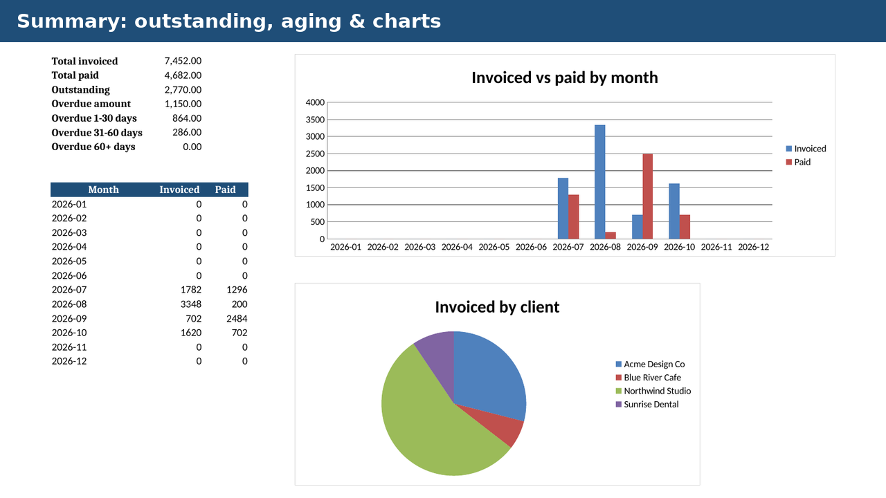

# Free Invoice & Client Payment Tracker (Excel / Google Sheets template)

A free **invoice tracker spreadsheet** for freelancers and small businesses: keep clients, invoices and payments in one workbook. Tax, totals, amount paid, balance and status (Paid / Partial / Open / Overdue) are calculated for you, including partial payments.

## What's in the free Lite version
- `Invoice_Client_Payment_Tracker_LITE.xlsx`, up to 25 invoices
- Automatic totals, balance and Paid / Partial / Open / Overdue status
- Works in Microsoft Excel, LibreOffice Calc and Google Sheets (File, Import)

## Want the full version?
The **Pro** version adds 500 invoice rows, 50 clients, a printable invoice sheet, an outstanding/overdue aging summary (1–30 / 31–60 / 60+ days) and monthly invoiced-vs-paid charts.
[Get Invoice & Payment Tracker Pro (US$12)](https://payhip.com/b/jd4yg) · [Other templates](https://payhip.com/ZeroaCem)

## Notes
Made with AI assistance and tested in LibreOffice. Check your local invoicing and tax requirements. Sample data is fictional. MIT licensed (Lite only).
